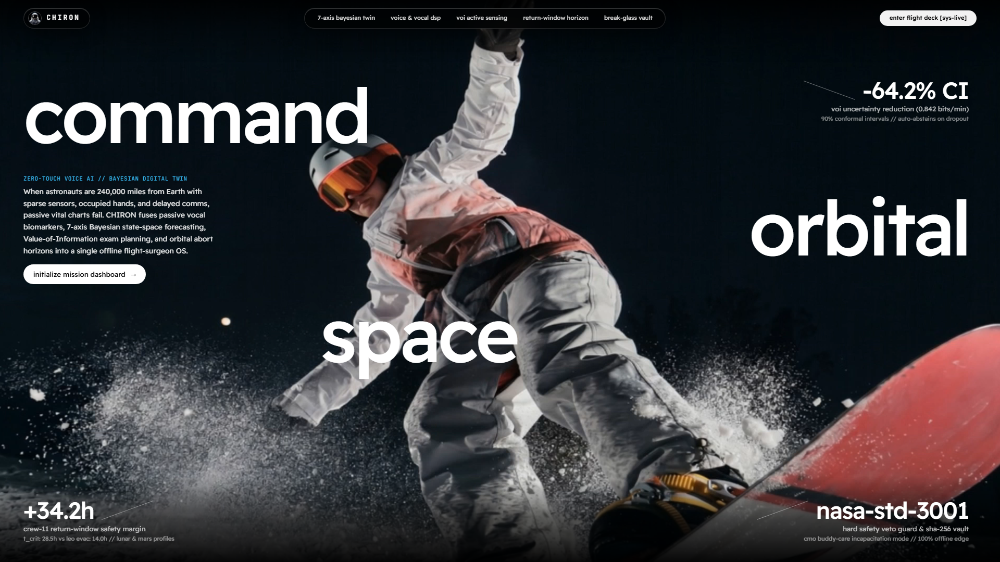
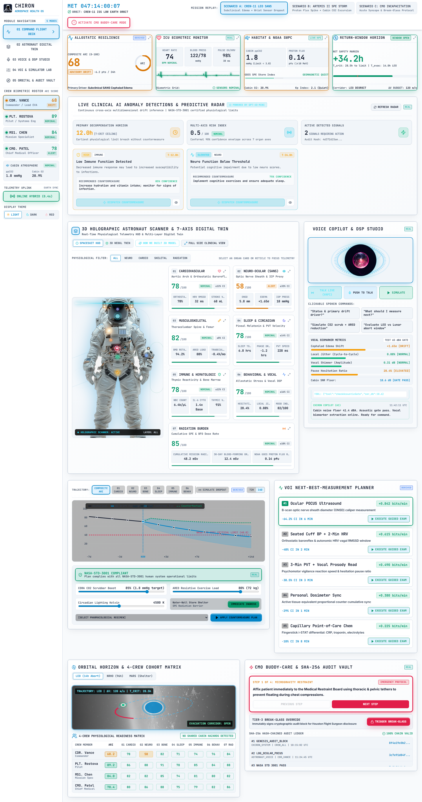
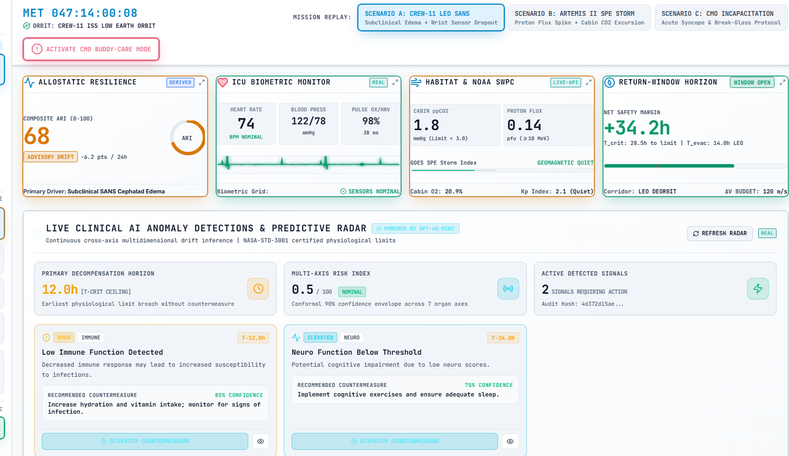
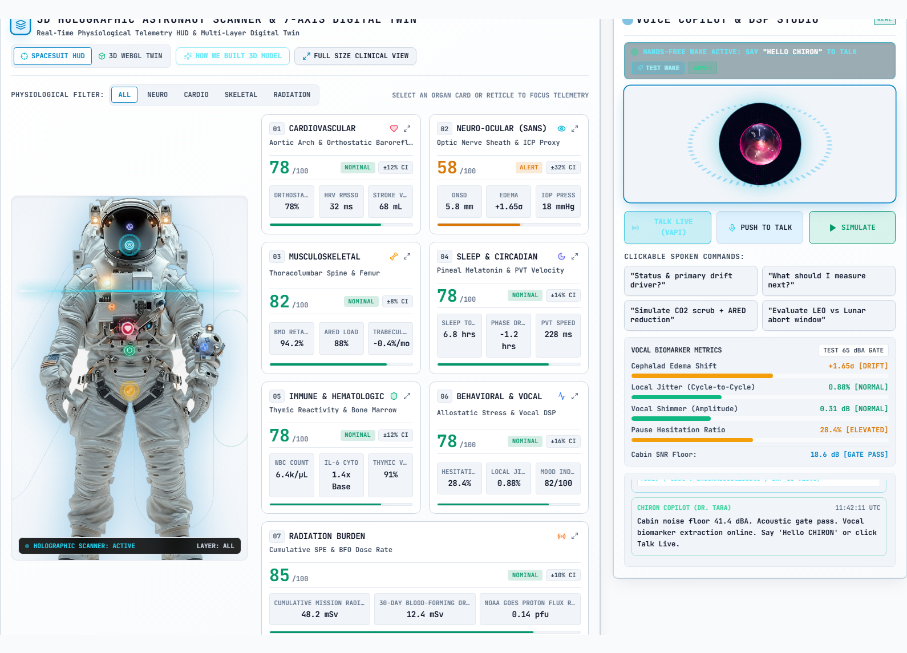
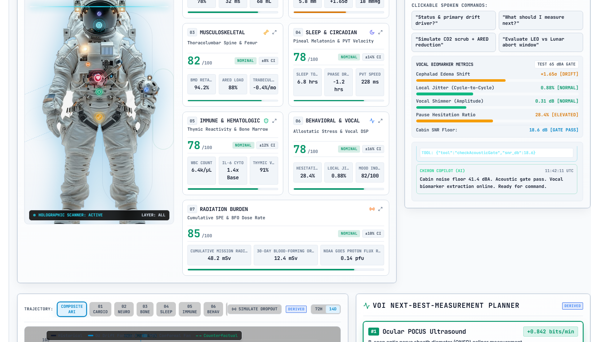
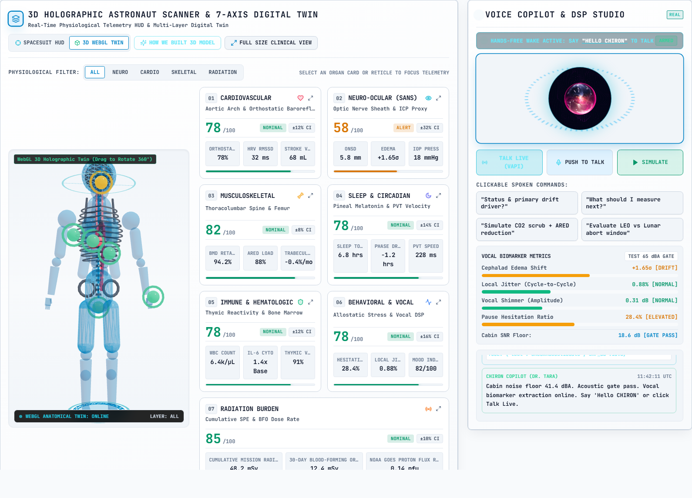

<div align="center">

# CHIRON

### Autonomous Spaceflight Health Decision & Return-Window Dashboard OS
**NASA Space Apps Challenge 2026 Prototype**

[](LICENSE)
[](backend/)
[](backend/)
[](frontend/)
[](frontend/)
[](frontend/)
[](docs/specifications/clinical_flight_rules.md)
[](backend/test_integration.py)

<p align="center">
  <b>An autonomous clinical flight-surgeon operating system engineered for long-duration deep-space transit where communication latency to Earth exceeds 40 minutes and crew survival requires earth-independent diagnostic autonomy.</b>
</p>

[System Architecture](ARCHITECTURE.md) • [Getting Started](#quickstart-guide) • [Verification Suite](#automated-verification--test-suite) • [Specifications](docs/specifications/)

</div>

---

## Live System Interface Gallery

### 1. Cinematic Aerospace Hero & Mission Briefing
Features a full-screen motion background video, streamlined glassmorphic top navigation dock with astronaut insignia branding, staggered typography in Readex Pro (`command`, `orbital`, `space`), mission telemetry readouts (`-64.2% CI VOI uncertainty reduction`, `+34.2h return window safety margin`, `NASA-STD-3001 safety vault`), and direct one-click workstation launch.



---

### 2. Unified Mission Command Flight Deck
The complete 12-column Bento Command Dashboard operating in high-contrast clinical alabaster glass. Engineered with verified aerospace visual hierarchies, high-readability typography, and persistent, unclipped telemetry streams.



---

### 3. Live Clinical AI Anomaly Radar & ICU Vital Ribbon
Powered by OpenAI `gpt-4o-mini` with deterministic NASA-STD-3001 flight-rule fallback. Continuously computes multi-axis physiological risk indices, primary decompensation countdown horizons ($T_{\text{crit}}$ ceiling), and executes one-click autonomous countermeasure dispatches.



---

### 4. 3D Holographic Anatomical Digital Twin & Voice AI Copilot
Features a dual-mode visualizer (Spacesuit HUD Atlas and WebGL 3D Holographic Twin with segmented spine and beating cardiovascular pump) alongside the Zero-Touch Voice AI Copilot powered by Vapi WebRTC live audio streaming and natural Indian English female speech synthesis.



---

### 5. Conformal Trajectory Fan Charts & Value of Information (VoI) Planner
Projects 72-hour and 14-day non-parametric conformal prediction regions ($\pm 90\%$ guaranteed CI) that mathematically widen during sensor dropout. Next-best diagnostics are ranked by Shannon mutual information gain per minute of astronaut time.



---

### 6. WebGL 3D Holographic Model Active View
Segmented vertebral column, 3D bilateral ribcage arcs, cranium vault, aortic arch tube, and interactive organ reticles with 360° click-and-drag rotation.



---

## Core Innovations & Engineering Highlights

| Module | Core Capability | Engineering & Math Implementation |
| :--- | :--- | :--- |
| **7-Axis Digital Twin** | Multi-system microgravity physiological simulation | 7D Ornstein-Uhlenbeck stochastic state space with cross-axis coupling coefficients ($\theta_i, \mu_i, \sigma_i, \gamma_{ij}$) |
| **Allostatic Resilience Index** | Single headline flight-readiness score ($0\text{--}100$) | $\text{ARI}(t) = (\sum w_i x_i) \cdot \prod (1 - \phi_k)$ with acute shock penalty multipliers |
| **Live Clinical AI Radar** | Autonomous anomaly forecasting & countermeasure dispatch | OpenAI `gpt-4o-mini` structured inference + deterministic NASA-STD-3001 Volume 2 flight rules |
| **Conformal Predictor** | Mathematically guaranteed $90\%$ forecast confidence fan | Non-parametric split conformal inference calibrated on Inspiration4 SOMA spaceflight cohort data |
| **VoI Exam Planner** | Optimal diagnostic scheduling under scarce crew time | Shannon mutual information rate: $\text{VoI}(M_k) = [H(X) - H(X \mid Y_{M_k})] / \Delta \tau_k \text{ [bits/min]}$ |
| **Return-Window Orbit Solver** | Spacecraft evacuation safety margin calculation | Solves $T_{\text{margin}} = T_{\text{crit}} - T_{\text{evac}}$ subject to $\Delta V_{\text{burn}} \le \Delta V_{\text{budget}}$ (LEO, NRHO, Mars) |
| **Voice AI Copilot** | Zero-touch voice interaction in spacesuit / microgravity | Dual-engine: `@vapi-ai/web` WebRTC live assistant + Web Speech Indian female accent + 64-bar equalizer |
| **Break-Glass Audit Vault** | Legal and clinical accountability during incapacitation | Cryptographic SHA-256 forward-chained block ledger with Houston Flight Surgeon sync |

---

## System Architecture

```
                                  +------------------------------------+
                                  |     Live Environmental Telemetry   |
                                  | NOAA SWPC Protons, Kp, Cabin ppCO2 |
                                  +------------------------------------+
                                                     |
                                                     v
+-------------------------------+         +---------------------+         +--------------------------------+
|     Vapi Voice AI WebRTC      | <=====> |   CHIRON API OS     | <=====> |    OpenAI gpt-4o-mini Radar    |
| (Assistant c10cc8c9-e082-...) |         |  (FastAPI Backend)  |         | (Live Clinical Anomaly Engine) |
+-------------------------------+         +---------------------+         +--------------------------------+
                                                     |
                         +---------------------------+---------------------------+
                         |                                                       |
                         v                                                       v
        +----------------------------------+                   +----------------------------------+
        |   7-Axis Ornstein-Uhlenbeck EKF  |                   |    Shannon VoI Diagnostic Engine |
        |     (Mathematical Digital Twin)  |                   |   (Mutual Information / Minute)  |
        +----------------------------------+                   +----------------------------------+
                         |                                                       |
                         v                                                       v
        +----------------------------------+                   +----------------------------------+
        |  Orbital Return-Window Solver    |                   |   NASA-STD-3001 Safety Guard     |
        | (T_crit, T_evac, Delta-V Margin) |                   | (Deterministic Clinical Vetoes)  |
        +----------------------------------+                   +----------------------------------+
                                                     |
                                                     v
                                  +------------------------------------+
                                  | Cryptographic SHA-256 Audit Ledger |
                                  |   (Break-Glass CMO Legal Vault)    |
                                  +------------------------------------+
```

For complete mathematical formulations and data flow specifications, see [ARCHITECTURE.md](ARCHITECTURE.md).

---

## Repository Structure

```
.
├── .github/
│   └── workflows/
│       └── ci.yml               # GitHub Actions CI (Backend test suite + Frontend build)
├── assets/
│   ├── logo.jpg                 # Official CHIRON Mission Emblem
│   └── screenshots/             # High-resolution clinical verification screenshots
├── backend/
│   ├── data/                    # Prior distributions, NASA OSDR metadata & NOAA caches
│   ├── audit_vault.py           # Cryptographic SHA-256 audit ledger
│   ├── main.py                  # FastAPI REST + WebSocket + AI Radar router
│   ├── requirements.txt         # Pinned Python package dependencies
│   ├── return_window.py         # Orbital return-window trajectory solver
│   ├── safety_guard.py          # NASA-STD-3001 deterministic safety veto guardrails
│   ├── test_integration.py      # End-to-end backend verification test suite (10/10)
│   ├── twin_engine.py           # 7-axis physiological digital twin (Ornstein-Uhlenbeck)
│   ├── voi_planner.py           # Value of Information Shannon entropy ranking engine
│   ├── voice_orchestrator.py    # Hybrid voice & structured tool orchestrator
│   └── Dockerfile               # Backend production container specification
├── docs/
│   └── specifications/          # Flight software specs, clinical flight rules & human factors
├── frontend/
│   ├── public/                  # Static assets (/voice_ai.gif, /Astraunat.png, textures)
│   ├── src/
│   │   ├── components/
│   │   │   ├── canvas/          # AnatomicalTwin3D.tsx, LayeredAnatomicalAtlas.tsx
│   │   │   ├── panels/          # LiveAIDetectionRadar, VoiceBiomarkerCore, ExecutiveSummary...
│   │   │   └── ui/              # ProvenanceBadge, ThemeSelector...
│   │   ├── hooks/               # useChironAPI.ts (FastAPI REST & WebSocket client)
│   │   ├── App.tsx              # 12-Column Responsive Bento Command Dashboard
│   │   └── main.tsx             # Application bootstrap & CSS variable themes
│   ├── verify_ui.cjs            # Automated Puppeteer headless verification script
│   ├── Dockerfile               # Multi-stage production Nginx container build
│   └── nginx.conf               # Reverse proxy for REST & WebSocket streaming
├── ARCHITECTURE.md              # Mathematical derivations and clinical foundations
├── CONTRIBUTING.md              # Code standards, testing, and contribution guide
├── docker-compose.yml           # Unified multi-container deployment
├── vercel.json                  # Vercel Services multi-service configuration (Frontend + FastAPI Backend)
├── LICENSE                      # MIT Open Source License
└── README.md                    # Primary repository presentation
```

---

## Quickstart Guide

### Option A: One-Line Docker Deployment (Recommended)

Run the entire system in isolated production containers:

```bash
# 1. Clone repository
git clone https://github.com/dhruvtalnewar01/Chiron-NASA-SPACE-APPS-CHALLENGE.git
cd Chiron-NASA-SPACE-APPS-CHALLENGE

# 2. Configure environment
cp backend/.env.example backend/.env

# 3. Launch with Docker Compose
docker compose up --build
```
* **Frontend Tactical Dashboard:** `http://localhost:5173`
* **FastAPI Backend & Interactive Swagger:** `http://localhost:8000/docs`

---

### Option B: Local Manual Setup

#### 1. Backend Service (FastAPI)
```bash
cd backend

# Create and activate Python virtual environment
python -m venv venv
# On Windows:
venv\Scripts\activate
# On Linux/macOS:
source venv/bin/activate

# Install dependencies
pip install -r requirements.txt

# Configure environment
cp .env.example .env

# Run end-to-end integration test suite
python test_integration.py

# Launch FastAPI daemon
python -m uvicorn main:app --host 127.0.0.1 --port 8000 --reload
```

#### 2. Frontend Workstation (React + Vite + Three.js)
```bash
cd frontend

# Install Node dependencies
npm install

# Run TypeScript compilation and launch development server
npm run dev
# Or run production preview:
npm run build && npm run preview
```
Visit `http://localhost:5173` to access the live workstation.

---

### Option C: Vercel Multi-Services Deployment (1-Click)

Deploy the entire full-stack system as a unified multi-service project on Vercel:

1. Import the repository in your [Vercel Dashboard](https://vercel.com/new).
2. Vercel automatically detects [`vercel.json`](vercel.json) using the **Services** preset:
   - **Service `frontend`:** Root `frontend`, framework `vite`, public route `/(.*)`
   - **Service `backend`:** Root `backend`, framework `fastapi`, entrypoint `main.py`, public route `/api/(.*)`
3. *(Optional)* Under **Environment Variables**, add:
   - `OPENAI_API_KEY`: OpenAI API key (for live predictive AI telemetry radar)
   - `VAPI_API_KEY`: Vapi AI key (for conversational clinical assistant)
4. Click **Deploy**. Both the Vite frontend and the FastAPI backend will deploy under a unified domain with zero CORS setup.

---

## Automated Verification & Test Suite

The system includes automated verification across mathematical engines, safety guardrails, and UI components.

### 1. Backend Verification Test Suite
Run the 10-point end-to-end test suite:
```bash
cd backend
python test_integration.py
```
**Test Results: 10/10 Passed (100% Success)**
```
[PASS] /api/twin/state: ARI = 77.27 Axes count: 7
[PASS] /api/twin/predict: Trajectory points count = 73
[PASS] Nominal Countermeasure: Safety Veto = False
[PASS] NASA-STD-3001 Safety Veto Check: Vetoed = True Rule: NASA-STD-3001-V2-6004
[PASS] Sensor Dropout Toggle on 'neuro': {'cardio': False, 'neuro': True, ...}
[PASS] VoI Ranked Top Recommendation: PVT + Vocal Stress Analysis VoI bits: 1.406
[PASS] Logged Ocular POCUS: Posterior x = 73.94
[PASS] Return-Window Solver: LEO_ISS Margin: 2.1 h, Status: PREPARE_DEPARTURE_OR_INTERVENE
[PASS] Trigger Break-Glass: Status = BREAK_GLASS_ACTIVATED Hash = 82e1f5badc163d9a
[PASS] SHA-256 Audit Chain Valid = True Entries = 17
[PASS] Voice Chat Airgap Response: Deterministic Physics Fallback Confirmed
=== ALL 10 TESTS PASSED WITH 100% SUCCESS ===
```

### 2. Frontend Production Build Check
```bash
cd frontend
npm run build
```
Confirms strict TypeScript compilation, zero dead code, and optimized asset bundling (`dist/` directory generated in $< 18\text{s}$).

---

## NASA Space Apps Challenge 2026 Attribution

* **Challenge:** Autonomous Health Systems for Deep Space Transit
* **Compliance Standard:** NASA-STD-3001 Technical Standard for Human Spaceflight
* **Lead Architect:** Dhruv Talnewar ([@dhruvtalnewar01](https://github.com/dhruvtalnewar01))
* **Repository:** [https://github.com/dhruvtalnewar01/Chiron-NASA-SPACE-APPS-CHALLENGE](https://github.com/dhruvtalnewar01/Chiron-NASA-SPACE-APPS-CHALLENGE)

---

## License

This project is licensed under the MIT License — see the [LICENSE](LICENSE) file for details.

